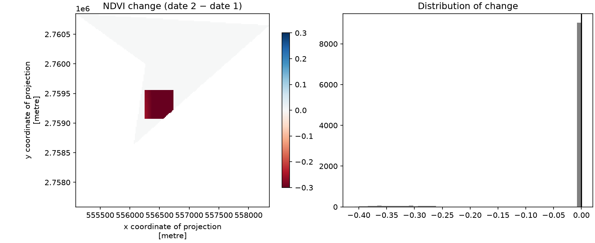

# Geospatial Vegetation Monitor

A small Python / Jupyter project that compares vegetation at one location between **two dates** using Sentinel-2 satellite imagery. It computes NDVI for each date, calculates the change, and shows it on an interactive map.

## Project structure

```
geospatial-vegetation-monitor/
├── data/
│   └── study_area.geojson     # INPUT: the study area (a GeoJSON Polygon)
├── config.json                # INPUT: dates, buffer size, thresholds, data source
├── vegetation_monitor.ipynb   # the notebook (run this)
├── helpers.py                 # functions used by the notebook
├── requirements.txt           # Python packages
├── outputs/                   # generated results
└── README.md
```

## Inputs

**`data/study_area.geojson`** is the study area (AOI, area of interest) as a `Polygon` in `[longitude, latitude]` order (EPSG:4326), about 51.55-51.58°E, 24.94-24.96°N in Qatar. The satellite pixels are clipped to this exact shape.

The file may also hold a `Point` instead. In that case the notebook turns it into a square AOI of ±`buffer_m` metres around the point.

**`config.json`**

| Key | Meaning | Default |
|---|---|---|
| `study_area_file` | Path to the GeoJSON | `data/study_area.geojson` |
| `buffer_m` | Half-width of the square AOI in metres. **Only used when the GeoJSON is a Point**; ignored for polygons | `2000` |
| `date_1`, `date_2` | Start/end of the two date windows | Jan-Feb 2025 and Jan-Feb 2026 |
| `max_cloud_percent` | Skip scenes cloudier than this | `20` |
| `data_source` | `planetary_computer` (real Sentinel-2) or `synthetic` (fake data, works offline) | `planetary_computer` |
| `change_threshold` | NDVI change counted as loss/gain | `0.1` |
| `diff_display_range` | Colour scale limit (±) for the change map | `0.3` |
| `output_dir` | Where results are saved | `outputs` |

To study another place, replace the GeoJSON (polygon or point). To compare other dates, edit `date_1` and `date_2` and keep both in the **same season**.

## How to run

```bash
python -m venv venv
source venv/bin/activate          # Windows: venv\Scripts\activate
pip install -r requirements.txt
jupyter notebook vegetation_monitor.ipynb
```

Run all cells. The first run needs internet access to search and read Sentinel-2 data from Microsoft Planetary Computer (free, no account needed for reading). To test the notebook without internet, set `"data_source": "synthetic"` in `config.json`.

## How it works

1. **Read the GeoJSON** (vector). A polygon is used as is; a point would be buffered into a square.
2. **Find imagery:** search Sentinel-2 Level-2A for the least cloudy scene in each date window. Date 2 uses the same tile as date 1 so both rasters share one pixel grid.
3. **Load bands:** red (B04) and near-infrared (B08), clipped to the AOI, converted to reflectance (0-1).
4. **NDVI:** `(NIR − Red) / (NIR + Red)` for each date.
5. **Compare:** `change = NDVI(date 2) − NDVI(date 1)`; count the area with change below `-threshold` (loss) and above `+threshold` (gain).
6. **Map:** reproject to EPSG:4326 and overlay NDVI for each date plus the change layer on a Folium map.

## Outputs (`outputs/`)

| File | Content |
|---|---|
| `aoi_polygon.geojson` | The AOI polygon created from the point |
| `ndvi_two_dates.png` | NDVI maps for both dates side by side |
| `ndvi_change.png` | Change map and histogram |
| `summary.csv` | Dates, mean NDVI, change, loss/gain area in km² |
| `ndvi_change_map.html` | Interactive map; open in any browser |

### Example output



## Key concepts

- **Raster:** grid of pixels with values (satellite bands). **Vector:** points, lines, polygons (the GeoJSON).
- **CRS:** how coordinates map to Earth. GeoJSON uses EPSG:4326 (degrees); the notebook works in UTM (metres) for areas and pixel sizes.
- **NDVI:** vegetation index from -1 to 1. Water < 0, bare soil/desert ≈ 0-0.1, sparse vegetation 0.2-0.4, dense vegetation 0.6+.
- **Temporal comparison:** same place, two dates, subtract. Use the same season and clear scenes.

## Limitations

- The study area is arid, so NDVI is low everywhere. Interpret the **change**, not the absolute values. Small changes can come from soil moisture, irrigation or sun angle rather than real vegetation change.
- Scenes are filtered by overall cloud percentage only; clouds or shadows inside the AOI can still cause false change. A natural next step is masking with the Sentinel-2 `SCL` band.
- Only two dates are compared. A monthly time series would show seasonal behaviour.

## Data source

Sentinel-2 Level-2A imagery (ESA / Copernicus) via the Microsoft Planetary Computer STAC API.
